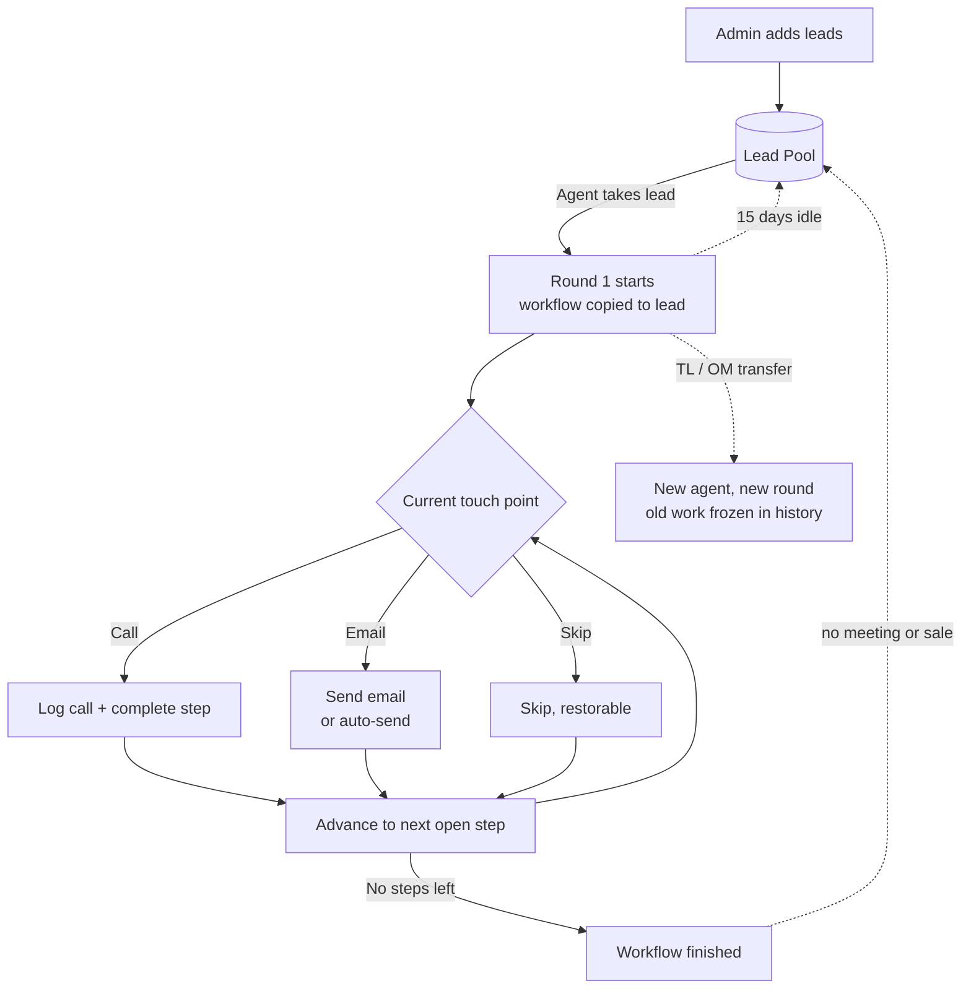
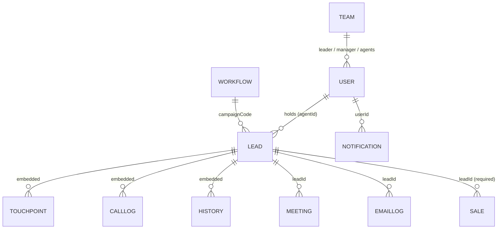

<div align="center">

# 📞 SalesFlow CRM

### A role-aware telesales CRM that turns a pile of leads into a disciplined, measurable sales machine.

**Automated call & email cadences · Lead pool with fair-play rules · Live leaderboards · Escalations · Deep analytics**


</div>

---

## ✨ Why SalesFlow?

Telesales teams lose money in the gaps: a lead nobody called back, a follow-up email that never went out, a manager who can't see who is actually working. **SalesFlow closes those gaps.**

Every lead moves through a **campaign workflow** (a fixed sequence of call and email "touch points"). The system schedules the next step, sends the emails, rescues stale leads, and shows every role exactly what they need to act on, and nothing they shouldn't see.

| Without SalesFlow | With SalesFlow |
|---|---|
| Agents cherry-pick easy leads | A **shared pool** with fair-play rules decides who can take what |
| Follow-ups depend on memory | Every lead has a **scheduled cadence**; today's work is one click away |
| Dead leads rot in someone's list | The **15-day rule** automatically frees them back to the pool |
| Managers ask "how is the team doing?" | Role-scoped **dashboards, funnels and leaderboards** answer it live |
| Problems get lost in chat | A ranked **escalation chain** (agent → Quality → TL → OM → Admin) |

---

## 🚀 Feature Highlights

### 🎯 Lead workflow engine
- **Campaign templates** (e.g. *Activation* and *Retention*, 7 steps each: Email → Call → Email → Call → Email → Call → Email) with configurable step type and day gaps, editable by Admins.
- **Work Queue** that sorts every lead into **Today / Next / Stop / Finished**, and inside each step by best call result: `Discovery > LVM > NVM`.
- **One-transaction call logging**: log the call *and* complete the touch point together.
- **Skip / restore / stop / resume** any step, with a full audit **history** on every lead.
- **Rounds**: when a lead changes hands, the previous agent's work is frozen in `previousAssignments` and the new agent starts a fresh round, so nothing is ever lost or mis-attributed.

### 🤖 Background automation
A scheduler ticks every 30 seconds and runs four safe, repeatable jobs:

| Job | What it does |
|---|---|
| **Auto-email** | Sends due email steps (Discovery or No-Response template), never twice for the same step (idempotency key) |
| **15-day rule** | Frees leads with no progress for 15 calendar days back to the pool, with history preserved |
| **Workflow finished** | Releases leads whose every step is done, unless a meeting or sale is pending |
| **Meeting reminder** | Notifies all participants 15 minutes before a meeting, exactly once |

### 🏊 Lead pool with fair-play
- Admins bulk-import leads by **pasting rows**, with a preview step that flags rejected rows before anything is saved.
- Agents **take leads from the pool**; a *recently worked* guard blocks grabbing a lead another agent touched in the last 15 days.
- TLs and OMs can **transfer** leads to agents in their scope.

### 🏆 Sales & leaderboards
- Quality-only sale recording (BP, PPI, MUA, ATEP, Activation, Retention, Transition).
- **Monthly targets** (28 per agent; team and manager targets roll up automatically).
- **Top 5 agents** with a smart tie-break: most Discovery calls, then most LVM, then name.
- Team-leader headers are visually distinct, and lead-level **"More details" are privacy-scoped** by role.
- **Data-quality checks** flag orphan, duplicate or mis-attributed sales.

### 📊 Role-scoped analytics
KPIs, conversion **funnel** (leads → contacted → reached → meetings → sold), breakdowns by **campaign, agent and hour**, comment classification, and a **week that starts on Saturday** to match the business calendar.

### 👥 Collaboration
Team Updates (with acknowledgements), Tasks, **Quality Tips**, Meetings & Calendar (with outcome tracking, reschedule and follow-up scheduling), an in-app **notification bell**, and per-page **"new since last visit" badges**.

### 🚨 Escalations
Raise a problem about anyone. Recipients must **outrank** both the reporter and the subject. The recipient can resolve it or **forward it up the chain**, and the person being escalated never sees it.

---

## 👤 Five Roles, One Source of Truth

| Role | Lands on | Superpowers |
|---|---|---|
| **Admin** | Lead Pool | Import/delete leads, build campaigns, create users, move agents between teams, assign managers & Quality |
| **Operation Manager (OM)** | Dashboard | Oversees multiple teams within a Line of Business (LOB); assigns tasks to TLs & Quality; transfers leads |
| **Team Leader (TL)** | Dashboard | Runs a team; assigns tasks and updates; schedules meetings; transfers leads |
| **Agent** | Dashboard | Takes leads, works the queue, logs calls and emails, books meetings |
| **Quality** | Sales | Records sales, sends tips, joins meetings for the agents they follow |

Permissions are **enforced in the store (reducers), not only in the UI**: a forbidden action is rejected even if the button were somehow reachable.

<details>
<summary><b>📋 Full page-access matrix</b></summary>

| Page | Admin | OM | TL | Agent | Quality |
|---|:-:|:-:|:-:|:-:|:-:|
| Lead Pool | ✅ | | | | |
| Campaigns | ✅ | | | | |
| Create User | ✅ | | | | |
| Dashboard | | ✅ | ✅ | ✅ | |
| Analytics | | ✅ | ✅ | ✅ | |
| Teams | ✅ | ✅ | ✅ | ✅ | ✅ |
| Work Queue | | | | ✅ | |
| My Leads | | | | ✅ | |
| Calendar | | ✅ | ✅ | ✅ | ✅ |
| Sales | | ✅ | ✅ | ✅ | ✅ |
| Team Updates | | ✅ | ✅ | ✅ | ✅ |
| Tasks | | ✅ | ✅ | ✅ | ✅ |
| Tips | | | | ✅ | ✅ |
| Escalations | ✅ | ✅ | ✅ | ✅ | ✅ |
| Email Center | | ✅ | ✅ | ✅ | |

</details>

---

## 🔄 Lead Lifecycle at a Glance



---

## 🏗️ Architecture

SalesFlow is a **React + Redux Toolkit** application built with strict separation of concerns:

```
src/
├─ app/          App shell, sidebar, role-based navigation, scheduler tick
├─ domain/       Pure business rules: no React, no Redux (fully unit-testable)
│  ├─ workflow/    touch points, call classification, lead queue, 15-day expiry
│  ├─ lead/        lead codes, pool eligibility, bulk import parsing
│  ├─ sales/       types, targets, leaderboard, legacy migration
│  ├─ analytics/   funnel, performance metrics, date ranges, data quality
│  ├─ escalation/  who may escalate to whom
│  └─ org/ email/ meeting/ updates/ user/
├─ store/        Everything that changes data
│  ├─ crm/reducers/   one reducer file per topic (leads, pool, calls, sales ...)
│  ├─ crm/scheduler/  the four background jobs
│  ├─ persistence/    debounced save, cross-tab sync, stored-state upgrade
│  └─ seed/           realistic demo dataset
├─ features/     One folder per screen (17 feature areas)
└─ shared/       Reusable components, hooks and utilities
```

**Design principles**

- **Dependency direction is one-way:** `features → store / domain / shared`, and `store → domain`. The domain layer knows nothing about the UI.
- **Single responsibility everywhere:** one file answers one question (e.g. `leadExpiryJob.ts` *is* the 15-day rule).
- **Open/closed:** a new feature is a new folder plus a new reducer file registered in `crmSlice`. No existing code needs to change.
- **Small, focused props** instead of passing the whole state around.
- **Intention-revealing action names:** `takeLeadsFromPool`, `logCallAndCompleteTouchPoint`, `transferLeadToAgent`, `runScheduledJobs`.

### Data model

The **lead is the heart of the system**: its touch points, call logs, history and previous assignments live *inside* the lead object, so a single record tells the whole story.



### Persistence & multi-tab safety
State is saved to `localStorage` with a **150 ms debounce** (and instantly on tab close). If another tab changes the data, this tab picks it up while **keeping its own signed-in user**. If the browser refuses to save, a **storage banner with a Backup button** appears. Legacy data (e.g. old sale types) is migrated automatically on read.

---

## 🔌 REST API (Backend Contract)

The repository includes a complete, interactive **API integration guide** ([`smart-telesales-apis.html`](./smart-telesales-apis.html)): 79 endpoints under `/api/v1`, with request/response models, error codes and worked examples. Open it in any browser.

| Area | Endpoints | Area | Endpoints |
|---|:-:|---|:-:|
| Auth | 4 | Team updates | 4 |
| Directory (users, teams) | 10 | Tasks | 5 |
| Campaigns & templates | 6 | Tips | 5 |
| Lead pool (Admin) | 5 | Sales | 4 |
| Lead pool (Agent) | 2 | Escalations | 6 |
| Leads | 3 | Notifications | 4 |
| Lead actions | 10 | Dashboard & analytics | 2 |
| Emails | 4 | Meetings | 5 |

**Production-minded details baked into the contract**

- 🔐 Short-lived **JWT access tokens (15 min)** with refresh-token rotation; login rate-limited per IP + username.
- 🔁 **Idempotency-Key** support on email, call and sale POSTs, so retries never duplicate.
- 🧾 A uniform error envelope `{ error: { code, message, details? } }` with 20+ machine-readable codes (`NOT_OWNER`, `LEAD_NOT_WORKABLE`, `HAS_SALE`, `TOUCHPOINT_NOT_OPEN` ...).
- ⚛️ **Atomic operations**: a Team Leader and their team are created in one transaction; rescheduling creates the new meeting and closes the old one together.
- 🕒 All times in ISO-8601 UTC; business dates on the **Africa/Cairo** clock.
- 🔔 Notifications never go to the person who performed the action, nor to disabled users.

---

## 🎨 UI Design System

Tailwind-only, responsive, and consistent:

- **Palette with meaning:** blue (primary) · emerald (success / Discovery) · amber (warning / voicemail) · rose (error / no response) · violet (meetings, Team Leaders) · cyan (call steps) · slate (neutral).
- **Mobile-first:** the sidebar becomes a slide-in drawer below `lg`; tables scroll horizontally; modals fit `92dvh`.
- **Collapsible hierarchy** (manager → teams → agents) and "done" sections keep dense screens calm.
- System font stack, [`lucide-react`](https://lucide.dev) icons, and no external font requests.

---

## 🧪 Try It in 2 Minutes

The app ships with a rich **demo dataset**: 2 Operation Managers, 6 teams, 21 agents, 2 Quality members and roughly **190 leads** with call history, meetings, sales, updates, tasks and tips.

1. Start the app (see below).
2. On the login screen, **pick any demo user**. Demo accounts accept any password.
3. Switch roles to see the same company through different eyes:
   - **Admin** → import leads, design a campaign.
   - **Agent** → *Take Leads*, work the **Work Queue**, log a call.
   - **Team Leader** → check the Dashboard, transfer a lead, post an update.
   - **Quality** → record a sale and watch the **Top 5** leaderboard move.
4. Need a clean slate? Run the `resetToSeedData` action.

---

## ⚙️ Getting Started

> The source in this repository is a **Vite + React + TypeScript** app using the `@/` path alias for `src/`.

```bash
# install dependencies
npm install

# run the dev server
npm run dev

# production build
npm run build
```

**Core dependencies:** `react`, `react-dom`, `@reduxjs/toolkit`, `react-redux`, `lucide-react`, `tailwindcss`.

---

## 📚 Documentation

| Document | What's inside |
|---|---|
| [`docs/ARCHITECTURE.md`](./docs/ARCHITECTURE.md) | Folder map, dependency rules, action naming, page list |
| [`docs/DATA_LIFECYCLE.md`](./docs/DATA_LIFECYCLE.md) | Collections, lead lifecycle, scheduler, persistence, meetings, sales |
| [`docs/ROLES_AND_PAGES.md`](./docs/ROLES_AND_PAGES.md) | Who can see and do what, notifications vs badges, LOB & escalations |
| [`docs/SALES.md`](./docs/SALES.md) | Sales page, leaderboard rules, privacy of lead details |
| [`docs/UI_DESIGN_SYSTEM.md`](./docs/UI_DESIGN_SYSTEM.md) | Colors, components, breakpoints |
| [`smart-telesales-apis.html`](./smart-telesales-apis.html) | Interactive REST API guide (79 endpoints) |

> 📝 The documents in `docs/` are written in Egyptian Arabic for the product team.

---

## 🗺️ Roadmap

- [ ] Connect the UI to the REST API (the contract is already defined)
- [ ] Move the four scheduler jobs to real server-side background workers
- [ ] Real email delivery (sending is currently simulated and logged in `emailLogs`)
- [ ] Hash-based credential storage (the prototype stores demo passwords in plain text, **for demo use only**)
- [ ] Automated tests for the pure `domain/` layer

---

## ⚠️ Prototype Notice

The front end currently runs **without a backend**: all data lives in one Redux `AppState` persisted to `localStorage` (key `sales-mgmt-state-v5`). Email sending is simulated. Do **not** use the demo authentication for real data.

---

<div align="center">

**Built to help sales teams call the right lead, at the right time, with nothing falling through the cracks.**

⭐ If you find this project useful, give it a star!

</div>
