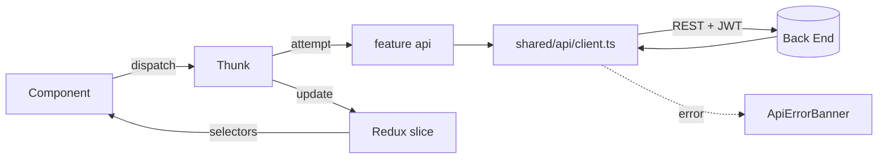

# Smart Telesales — Front End

The web application of **Smart Telesales**, a CRM for telesales teams. It gives every person in a call-center
(Admin, Operation Manager, Team Leader, Agent, Quality) one workspace for the whole sales cycle: from the shared
lead pool, through daily calls and meetings, to recorded sales and analytics. Agents also get an **AI call assistant**
that prepares them before each call.

> **Part of a full-stack project.** This repo folder is the client. It talks to the
> [Back End API](../backend/README.md) over REST. See the [project overview](../README.md) for the big picture.

| | |
|---|---|
| **Live demo** | [https://smart-telesales-demo.vercel.app/](https://smart-telesales-demo.vercel.app/) |
| **Source code** | [https://github.com/Anas-hisham/smart-telesales](https://github.com/Anas-hisham/smart-telesales) |
| **API reference** | [https://smart-telesalesapis.vercel.app/](https://smart-telesalesapis.vercel.app/) |

---

## Table of contents

1. [What you can do with it](#1-what-you-can-do-with-it)
2. [Tech stack](#2-tech-stack)
3. [Getting started](#3-getting-started)
4. [Architecture](#4-architecture)
5. [Roles and pages](#5-roles-and-pages)
6. [Business rules enforced in the UI](#6-business-rules-enforced-in-the-ui)
7. [Project structure](#7-project-structure)
8. [How to add a new feature](#8-how-to-add-a-new-feature)
9. [Good to know](#9-good-to-know)

---

## 1. What you can do with it

The app shows each role only what it needs.

| Role | What they do here |
|---|---|
| **Admin** | Loads leads into the shared **Lead Pool** (single add, paste, or import), builds **Campaigns**, creates users, moves agents between teams, assigns managers and Quality, manages the AI **knowledge base**. |
| **Operation Manager** | Runs one line of business (LOB). Sees every team under them in the dashboard and analytics, sends updates and tasks, manages the AI **knowledge base**. |
| **Team Leader** | Leads one team. Tracks each agent's calls, emails, meetings and sales against the daily target, and reassigns expired leads. |
| **Agent** | Takes leads from the pool, works a daily **Work Queue**, opens the **AI call assistant** before a call, logs calls, arranges meetings, and records progress. |
| **Quality** | Follows agents of one LOB, records sales, and sends tips to agents. |

Main screens (14 pages):

- **Work Queue** – the agent's daily screen. Leads are grouped by campaign, then **Today / Next / Stop**, then by
  touch-point step (call or email). Includes call logging, skip/restore, a lead detail drawer and the **AI call
  assistant** popup.
- **Dashboard** – role-specific progress against targets (team and agent level).
- **Analytics** – lead-to-sale funnel, answer and reach rates, best calling hours, and the reasons customers give,
  by campaign and agent, plus a data-quality warning when numbers are unreliable.
- **Lead Pool / My Leads / Take Leads** – the lead lifecycle from the shared pool to an agent's list.
- **Campaigns** – ordered touch points (call / email) with day offsets, used to build each lead's steps.
- **Calendar** – meetings, with reminders and required outcomes.
- **Sales** – monthly targets per agent, team and OM, top agents, and sale details.
- **Team Updates, Tasks, Tips, Escalations** – internal communication between roles.
- **Teams, Create User** – organisation structure and account management.
- **AI knowledge base** – where Admins and Operation Managers write and maintain the company information (products,
  prices, features, answers) that the AI call assistant is allowed to use.

---

## 2. Tech stack

| Technology | Used for |
|---|---|
| **React 18 + TypeScript** (StrictMode) | UI |
| **Vite** | Dev server and build. `@/` is an alias for `src/` |
| **Redux Toolkit + react-redux** | Global state (one slice per feature) and async actions (thunks) |
| **Tailwind CSS** | All styling |
| **lucide-react** | Icons |
| **fetch**, wrapped in `shared/api/client.ts` | HTTP |

There is no routing library: the current page is a `useState<PageId>` in `App.tsx`, and access is decided by the
role table in `app/navigation.ts`.

The AI model (Google Gemini) is never called from the browser. The client only talks to the back end.

---

## 3. Getting started

**Requirements:** Node.js 18+ and a running copy of the [back end](../backend/README.md).

```bash
npm install
npm run dev
```

(The commands above assume the standard Vite scripts in `package.json`.)

### Environment variable

| Variable | Default | Meaning |
|---|---|---|
| `VITE_API_URL` | `http://localhost:3000/api` | Base URL of the REST API (trailing slashes are removed) |

> **Important:** the back end in this project mounts its routes on **`/api`**. Create a `.env` file
> next to `package.json` and set:
>
> ```env
> VITE_API_URL=http://localhost:3000/api
> ```
>
> If this is wrong, every request returns `404`.

Back-end CORS must allow the origin of the front end (`CORS_ORIGINS` in the back end's environment).

The AI call assistant needs no front-end setting. Its API key lives on the back end (see the
[Back End README](../backend/README.md)).

---

## 4. Architecture

### 4.1 Feature-based folders

Each feature lives in `src/features/<name>/` and uses the same optional sub-folders, so any feature is easy to find
and change on its own:

| Folder | Contents |
|---|---|
| `types/` | TypeScript interfaces of the data |
| `api/` | One object of functions that call the REST endpoints (nothing else) |
| `thunks/` | Async Redux actions: call the API, then update the store |
| `slice/` | Redux slice (state and reducers) |
| `schema/`, `utils/`, `constants/` | Pure validation, business rules, labels and colours |
| `hooks/` | React hooks (data loading, UI state) |
| `components/` | Reusable UI pieces of the feature |
| `pages/` | The screen opened from the menu |

### 4.2 Data flow

The **server is the source of truth**. The Redux store is only a copy of what the server sent. The only thing saved
in the browser is the login tokens (`localStorage`, key `salesflow-auth-v1`).



**Write pattern:** a UI event dispatches a thunk. The thunk wraps the call in `attempt(() => api.fn())`. On success it
updates the store (upsert the returned object, or reload a collection) and returns `true`, so the UI can close its
modal. On failure `attempt` shows a red banner and returns `undefined`.

### 4.3 Start-up sequence

1. `main.tsx` renders `Provider` → `ErrorBoundary` → `App` (+ `ApiErrorBanner`).
2. The auth slice starts as `booting` if tokens exist in `localStorage`, otherwise `anonymous`.
3. While `booting`, the app calls `GET /auth/me`, then loads everything the person can see in one go
   (teams, campaigns, users, meetings, updates, tasks, tips, escalations, notifications, badges and the agent's leads).
4. `anonymous` shows the login page; otherwise the app shell and the current page render.

### 4.4 Authentication and tokens

- Requests send `Authorization: Bearer <accessToken>`.
- On `401 TOKEN_EXPIRED`, the client calls `/auth/refresh` **once** (parallel requests share a single refresh) and
  repeats the original request.
- If renewing fails, the session ends and the user returns to the login page. Every slice empties itself on
  `sessionEnded`.

### 4.5 Keeping data fresh

`useSyncTick` reloads notifications, meetings, menu badges and (for agents) leads **every 30 seconds while the tab is
visible**, and again when the tab becomes visible. The browser only polls: the 15-day lead expiry and the
meeting reminders run on the server.

### 4.6 Errors

- `ApiError` (`status`, `code`, `message`, `details`) is the only error type that leaves the API client.
- `ApiErrorBanner`, mounted once, shows errors for 8 seconds. Neutral notices use a dark banner.
- `ErrorBoundary` catches render crashes and offers *Try again* / *Reload*.
- Requests that must never be saved twice (log a call, record a sale) send an `Idempotency-Key` header.
- Many hooks use a stale-response guard, so a slow answer never overwrites a newer one.

### 4.7 AI call assistant

Before each call, the agent opens a popup from the lead (Work Queue or lead drawer). The popup shows:

- a **personalised call script**;
- **predicted customer objections**, each with a ready-to-say answer;
- a **customer brief**;
- **next steps**.

How the client handles it:

- The popup asks the back end for the lead's assistant content. The server builds the prompt from the lead's call
  history and the company knowledge base, calls Google Gemini, and returns **validated** structured JSON. The client
  therefore renders a fixed shape and never parses raw model text.
- Results are **cached per lead on the server**, so reopening the popup for the same lead is fast and does not spend
  model calls.
- Generation can be **streamed**, so the popup can show content as it arrives, with a loading state before that.
- Failures (rate limit, model outage, permission) arrive as a normal `ApiError` and appear in the `ApiErrorBanner`.
  The popup uses the same stale-response guard as other hooks, so closing it or switching lead never shows an old
  answer.
- **No phone number or e-mail is sent to the model.** The server removes them, and server-side lead permissions apply
  to every AI request, so an agent can only open the assistant for a lead they may see.
- The **knowledge base** screen is available to Admin and Operation Manager. Agents read the results, not the source.

---

## 5. Roles and pages

| Page | Menu label | Allowed roles |
|---|---|---|
| `adminleads` | Lead Pool | Admin |
| `campaigns` | Campaigns | Admin |
| `users` | Create User | Admin |
| `dashboard` | Dashboard | Operation Manager, Team Leader, Agent |
| `analytics` | Analytics | Operation Manager, Team Leader, Agent |
| `teams` | Teams | All five roles |
| `workqueue` | Work Queue | Agent |
| `calendar` | Calendar | OM, TL, Agent, Quality |
| `leads` | My Leads | Agent |
| `sales` | Sales | OM, TL, Agent, Quality |
| `updates` | Team Updates | OM, TL, Agent, Quality |
| `tasks` | Tasks | OM, TL, Agent, Quality |
| `escalations` | Escalations | All five roles |
| `tips` | Tips | Agent, Quality |

The **AI call assistant** is a popup opened from the agent's lead screens, not a menu page. The **AI knowledge base**
screen is for Admin and Operation Manager only.

Landing page after sign-in: Quality → Sales, Admin → Lead Pool, everyone else → Dashboard. If the open page is not
allowed for the role, the app shows the home page instead.

> The UI hides pages by role for convenience. **Real permissions are enforced by the back end**, which scopes every
> response to the people each role is allowed to see.

---

## 6. Business rules enforced in the UI

| Rule | Where |
|---|---|
| A lead with no progress for **15 days** leaves the agent's queue and waits for the Team Leader to reassign it | `leads.constants`, `leadExpiry` |
| A lead that left an agent's queue cannot be taken by **another** agent for 15 days; the previous agent can retake it at once | `leads.constants`, Take Leads |
| A campaign is an ordered list of touch points (call / email) with a day offset; max 20 touch points and 90-day gap | `campaigns.constants` |
| Queue bucket: stopped → **Stop**; no open touch point → finished; due today or overdue → **Today**; later → **Next** | `leadQueue` |
| Lead category by best call: **Discovery > LVM > NVM**; no calls = New; an arranged meeting counts as Discovery | `callClassification` |
| Monthly sales target = 28 per agent; Team Leader = agents × 28; OM = sum of teams | `sales.constants` |
| OM has a LOB (REG or DJ); teams, TLs and agents take their OM's LOB; Quality follows only agents of its LOB | `orgRules` |
| A Team Leader is always created together with a new team; an agent joins an existing team | `users.schema` |
| Password ≥ 8 characters; daily call target 1–500 (default 90) | `users.schema` |
| Lead IDs: letters and digits only; max 1000 rows per import or paste | `leadCode.schema` |
| Completing a meeting requires a written outcome; only its creator can change its status | `MeetingDetailModal` |
| Agents never delete leads (they remove them back to the pool); only Admin deletes | thunks, `LeadPoolPage` |
| The AI call assistant is for agents; the AI knowledge base is edited only by Admin and Operation Manager | `navigation`, AI assistant feature |

---

## 7. Project structure

```
src/
├─ main.tsx, index.css
├─ app/            App.tsx, navigation.ts, navBadges.ts, layout/ (AppShell, Sidebar, UserMenu)
├─ store/          index.ts, rootReducer.ts, selectors.ts, hooks.ts, types.ts
├─ shared/
│  ├─ api/         client.ts, attempt.ts, apiErrors.ts, api.types.ts
│  ├─ components/  AgentPicker, PersonPicker, LeadPicker, Collapsible, DoneSection,
│  │               Pagination, ConfirmDialog, ErrorBoundary, ApiErrorBanner, UserAvatar
│  ├─ hooks/       usePagination.ts
│  ├─ lib/         dates.ts, roleLabel.ts, uid.ts, upsertById.ts
│  └─ constants/   formStyles.ts, leadStatusStyles.ts
└─ features/
   auth · users · teams · campaigns · leads · take-leads · lead-pool · my-leads · work-queue
   meetings · tasks · tips · team-updates · escalations · notifications · sales · dashboard
   analytics · workspace · AI call assistant and knowledge base
```

About 190 source files (TypeScript and TSX). A file-by-file reference for every function is in the
[full front-end documentation](../docs/frontend-documentation.md).

---

## 8. How to add a new feature

1. Create `src/features/<name>/` with `types`, `api`, `thunks`, `slice`, `components`, `pages` as needed.
2. `api/<name>.api.ts`: an object of functions that use `get / post / put / patch / del` from `shared/api/client`.
3. `slice/<name>.slice.ts`: `createSlice` with `setX` / `xUpserted` reducers, and an `extraReducers` case that
   resets the state on `sessionEnded`.
4. `thunks/<name>.thunks.ts`: wrap each API call in `attempt(...)`, update the slice, return a boolean.
5. Register the reducer in `store/rootReducer.ts` and expose it in `store/selectors.ts` and `store/types.ts`.
6. If it should load at sign-in, add it to `workspace/thunks/workspace.thunks.ts`.
7. Add a `PageId` and a `NavItem` (with roles) in `app/navigation.ts`, and render the page in `app/App.tsx`.

Reuse `useConfirm`, `Pagination`, `DoneSection`, `Collapsible` and the pickers for a consistent look and feel.

---

## 9. Good to know

- **Only agents keep leads in Redux.** Other roles (Admin, TL, OM, Quality) load lead lists directly from the API on
  their pages.
- **Sales and dashboard data are not kept in Redux.** `recordSale`, `deleteSale` and `transferLeadToAgent` return a
  result, and their pages reload the data themselves.
- **Email touch points** are completed by copying the text or opening the mail app (`mailto:`), then marking the step
  as done. The app does not send email itself.
- **The AI call assistant is grounded, not free-form.** It only knows the lead's call history and the knowledge base.
  If the knowledge base is empty or thin, the script will be generic, so keep it up to date.
- **Candidates for cleanup:** a duplicate `tasks.api.ts` inside `features/tasks/components/`, and the
  `LeadImportModalShell` that lives in `lead-pool` but is used by several features (it could move to `shared/`).
- **Tokens** are stored in `localStorage`. This is simple and fine for a demo; a production deployment may prefer
  `httpOnly` cookies.

---

## Related documentation

- [Back End README](../backend/README.md)
- [Project overview and idea](../docs/PROJECT_OVERVIEW.md)
- [Full front-end documentation](../docs/frontend-documentation.md)
- [API reference](https://smart-telesalesapis.vercel.app/)
